

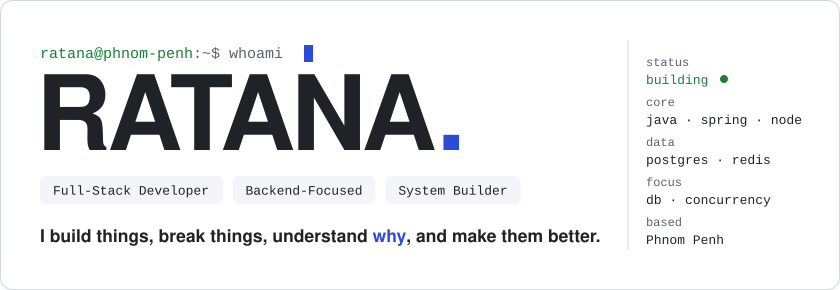

 

---

## ⚡ ENGINEERING MINDSET

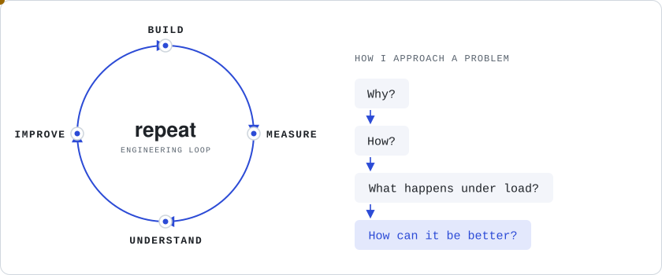

---

## 🧠 WHO I AM

I'm a **backend-focused full-stack developer** who enjoys understanding how software works beneath the surface.

I care about more than making an application work.

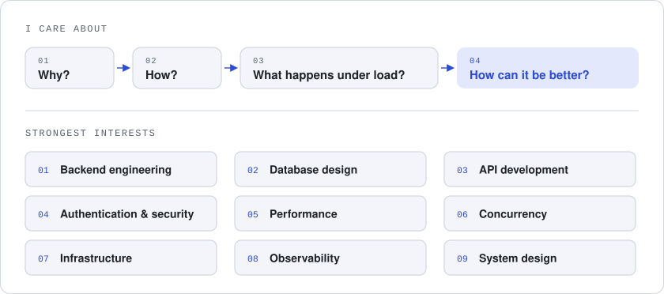

---

## 🛠️ MY TOOLBOX

My stack, layer by layer, the way a request travels through it.

| Layer | Tools | What I use them for |
| ----- | ----- | ------------------- |
| **Client** |  | Web UIs with React & Next.js in TypeScript, plus mobile apps with Flutter |
| **Edge** |  | Reverse proxying, TLS and load balancing on Linux servers |
| **Services** |  | REST APIs with Spring Boot (Spring Security, JPA/Hibernate) and Node.js/Express — where I spend most of my time |
| **Data** |  | PostgreSQL as the source of truth, Redis for caching, MongoDB for document data |
| **Ship & Observe** |  | Containerized deploys, version control & CI, and metrics dashboards to see what's really happening |

---

## 🔥 WHAT I'M INTO

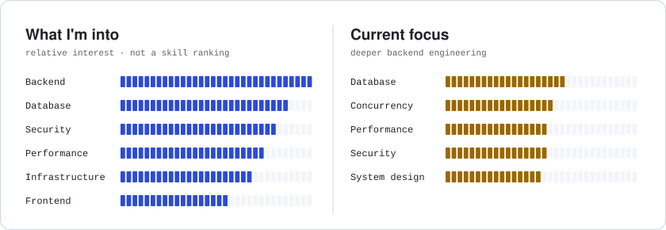

> Not a skill ranking — just the areas I enjoy exploring.

---

## 🧩 HOW I LEARN

I prefer learning by **building and investigating**.

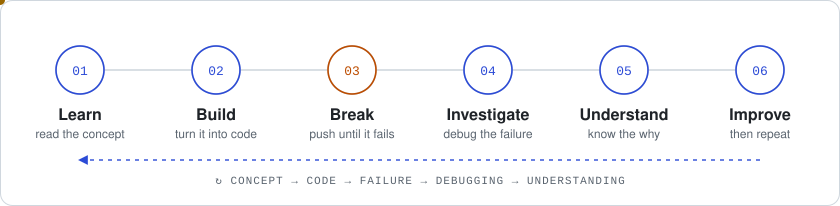

---

## 📚 CURRENTLY LEARNING

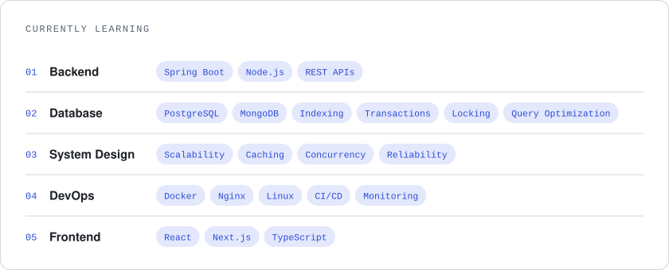

---

## 📈 MY GROWTH LOOP

Every project starts with a question and ends with a better one.

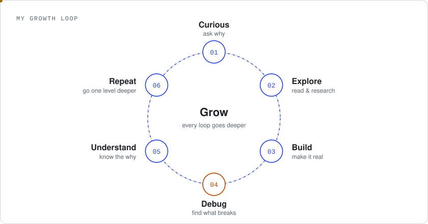

---

## 🎯 WHAT I VALUE

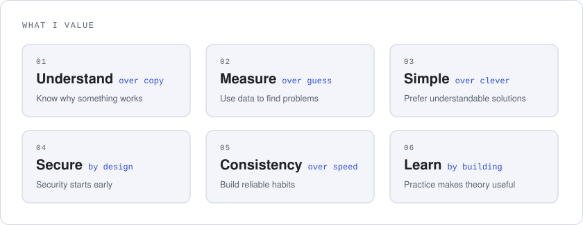

---

## 🔍 UNDER THE HOOD


## 📊 CASE STUDY

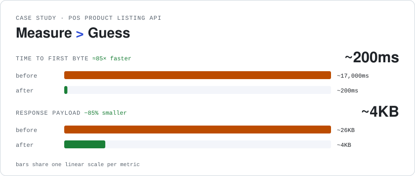

---

## 🌱 A LITTLE MORE

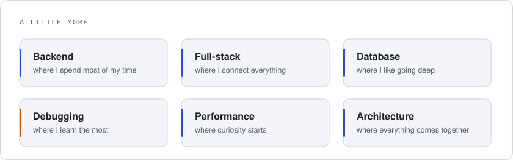

---

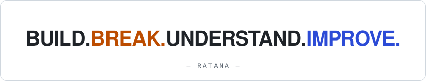

 

